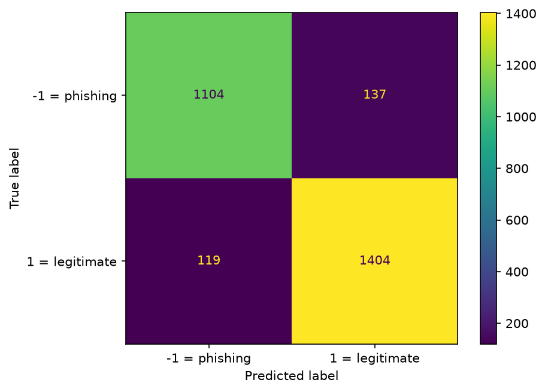
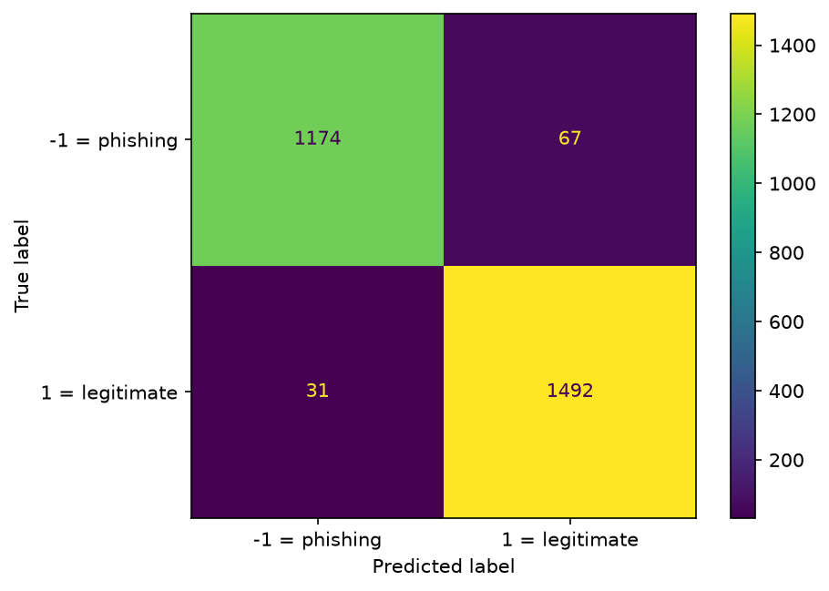

# Phishing Website Classifier
A machine learning project for detecting phishing websites using Python and scikit-learn, based on the [Phishing Websites dataset](https://archive.ics.uci.edu/dataset/327/phishing+websites) from the UCI Machine Learning Repository.  

View the full analysis in the [Jupyter Notebook](https://github.com/irakump/phishing-website-classifier/blob/main/phishing-website-classifier.ipynb).

The project consists of two parts:  
1. **Decision Tree**: Build an interpretable classifier, evaluate its performance, visualize the decision tree, and translate its rules into practical instructions for identifying phishing websites.  
2. **Random Forest**: Train and evaluate a random forest classifier, experiment with hyperparameter tuning, and compare its performance with the decision tree.

The project follows the CRISP-DM process, focusing on developing and evaluating machine learning models. Deploying the models is beyond the scope of this project.

## Key Findings
 
- A small, human-readable decision tree (max depth 4) reaches 90.7 % accuracy on the test set.
- A random forest (100 trees) improves this to 96.5 % accuracy and identifies 94.6 % of phishing websites.
- Both models rely mostly on the same two features: `sslfinal_state` (SSL certificate state) and `url_of_anchor` (where the links on the page point to).
- The accuracy gap should be interpreted with care: the tree was deliberately limited to depth 4 for readability, while the forest's trees were not depth-limited.

The following table compares the performance of the two models on the test set. The test set consists of 2,764 websites (1,241 phishing, 1,523 legitimate).  

| Model | Accuracy | Phishing precision | Phishing recall |
|---|---|---|---|
| Decision tree (max depth 4) | 0.91 | 0.90 | 0.89 |
| Random forest (100 trees) | 0.96 | 0.97 | 0.95 |

The confusion matrices below show the same comparison as counts of individual websites.

<table> <tr> <td align="center"><b>Decision tree (max depth 4)</b></td> <td align="center"><b>Random forest (100 trees)</b></td> </tr> <tr> <td></td> <td></td> </tr> </table>

In the confusion matrices, rows are the true classes and columns are the predicted ones, so the top-left cell is phishing sites correctly caught (true positive) and the top-right cell is phishing sites that slipped through as "legitimate" (false negative).  

The random forest performs clearly better on both error types: it misses about half as many phishing sites as the decision tree (67 vs. 137) and raises far fewer false alarms (31 vs. 119). In total, the forest misclassifies 98 of the 2,764 test websites, compared with 256 for the tree.

