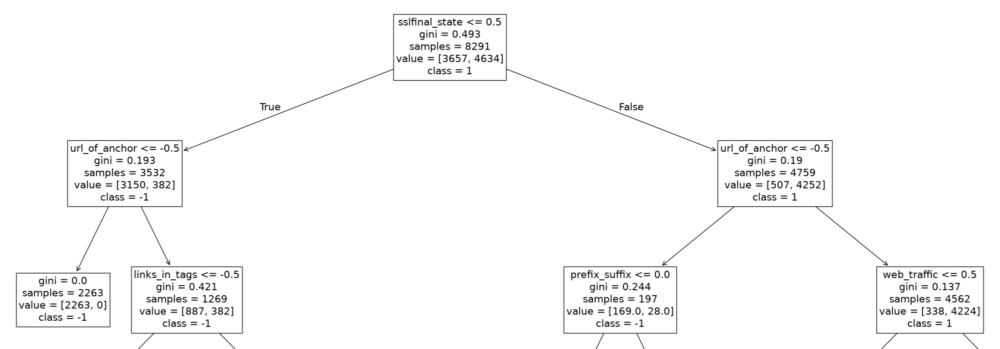

# Phishing Website Classifier
A machine learning project for detecting phishing websites using Python and scikit-learn, based on the [Phishing Websites dataset](https://archive.ics.uci.edu/dataset/327/phishing+websites) from the UCI Machine Learning Repository.  

View the full analysis in the [Jupyter Notebook](https://github.com/irakump/phishing-website-classifier/blob/main/phishing-website-classifier.ipynb).

The project consists of two parts:  
1. **Decision Tree**: Build an interpretable classifier, evaluate its performance, visualize the decision tree, and translate its rules into practical instructions for identifying phishing websites.  
2. **Random Forest**: Train and evaluate a random forest classifier, experiment with hyperparameter tuning, and compare its performance with the decision tree.

The project follows the CRISP-DM process, focusing on developing and evaluating machine learning models. Deploying the models is beyond the scope of this project.

## Key Findings
 
- A small, human-readable decision tree (max depth 4) reaches 90.7 % accuracy on the test set.
- A random forest (100 trees) improves this to 96.5 % accuracy and identifies 94.6 % of phishing websites.
- Both models rely mostly on the same two features: `sslfinal_state` (SSL certificate state) and `url_of_anchor` (where the links on the page point to).
- The accuracy gap should be interpreted with care: the tree was deliberately limited to depth 4 for readability, while the forest's trees were not depth-limited.

The following table compares the performance of the two models on the test set. The test set consists of 2,764 websites (1,241 phishing, 1,523 legitimate).  

| Model | Accuracy | Phishing precision | Phishing recall |
|---|---|---|---|
| Decision tree (max depth 4) | 0.91 | 0.90 | 0.89 |
| Random forest (100 trees) | 0.96 | 0.97 | 0.95 |

The confusion matrices below show the same comparison as counts of individual websites.

<table> <tr> <td align="center"><b>Decision tree (max depth 4)</b></td> <td align="center"><b>Random forest (100 trees)</b></td> </tr> <tr> <td></td> <td></td> </tr> </table>

In the confusion matrices, rows are the true classes and columns are the predicted ones, so the top-left cell is phishing sites correctly caught (true positive) and the top-right cell is phishing sites that slipped through as "legitimate" (false negative).  

The random forest performs clearly better on both error types: it misses about half as many phishing sites as the decision tree (67 vs. 137) and raises far fewer false alarms (31 vs. 119). In total, the forest misclassifies 98 of the 2,764 test websites, compared with 256 for the tree.

## Data
 
The dataset has 11,055 websites described by 30 features, such as URL structure, SSL certificate state, where the page's links point to, and domain age and traffic. The target is `result` (-1 = phishing, 1 = legitimate). All features are already integers and there are no missing values, so no data preparation was needed. The data was split 75 % / 25 % into training (8,291 websites) and test (2,764 websites) sets, and the same split is used for both models.
 
## Part 1: Decision Tree
 
I first tried cost-complexity pruning, but the unpruned tree had the best validation accuracy (0.959) and every pruned version was worse. Because the goal was a tree a person can actually read, I limited the depth instead. Validation accuracy kept improving up to depth 10 (0.949), but I chose depth 4 (0.919) as a trade-off between accuracy and readability.
 
The tree's first split is on `sslfinal_state`, and both branches then split on `url_of_anchor`. Together these two features already separate the data well. A low `sslfinal_state` combined with a low `url_of_anchor` is the clearest phishing signal: all 2,263 training sites in that group are phishing. On the other side, sites with a high `sslfinal_state` are mostly legitimate (4,252 of 4,759).
 
The image below shows the top of the tree: the root and the first two levels. The full tree and a step-by-step checklist derived from it are in the notebook.
 


## Part 2: Random Forest
 
I kept 100 trees and tuned `max_samples` and `max_features` (0.5, 0.7, 0.85 and 1.0), comparing all 16 combinations with 10-fold cross-validation on the training set. The best mean accuracy (0.9705) came from `max_samples=0.85` and `max_features=0.5`, which I used for the final model.
 
The forest agrees with the tree about what matters most: `sslfinal_state` has an importance of 0.49 and `url_of_anchor` 0.21. Most of the remaining features contribute very little.
 
## Limitations
 
- The model comparison isn't completely fair, since the tree was limited to depth 4 and the forest's trees were not.
- The test results come from one train/test split only. Evaluating with repeated splits or cross-validation would show how stable the results are.

## Tools
 
Python, scikit-learn, NumPy, Matplotlib, Jupyter Notebook
 
## Running the Notebook
 
```bash
pip install ucimlrepo scikit-learn numpy matplotlib jupyter
jupyter notebook phishing-website-classifier.ipynb
```
 
The dataset is downloaded automatically with the `ucimlrepo` package, so no separate data files are needed.
